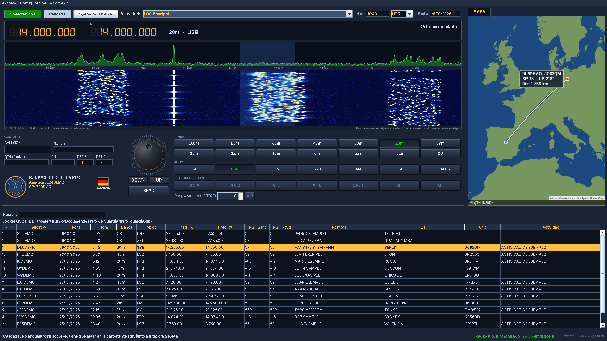
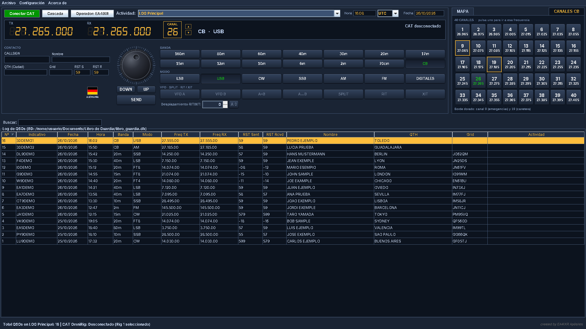
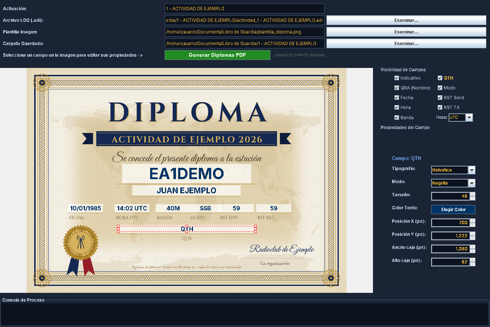
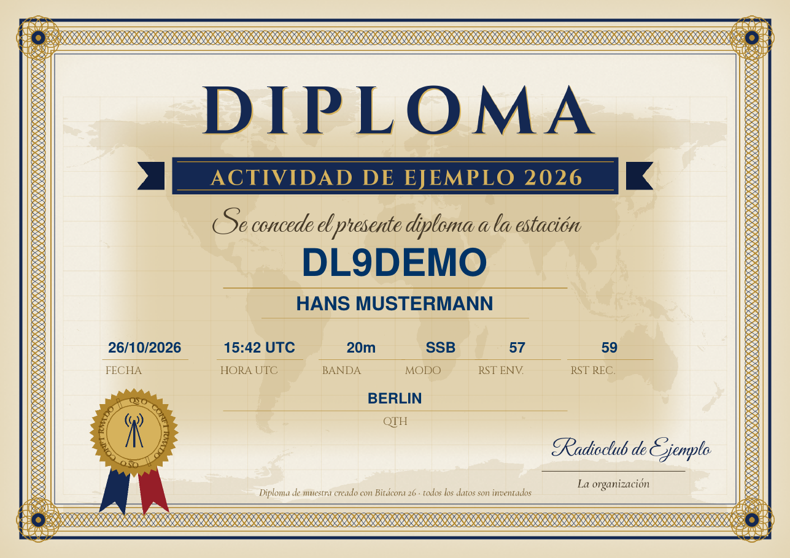
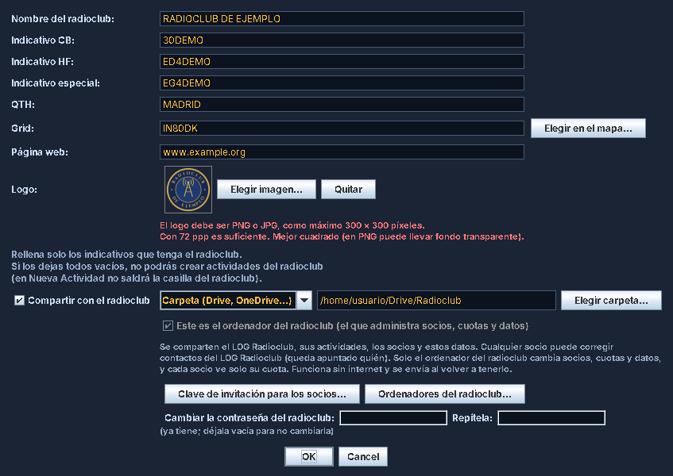
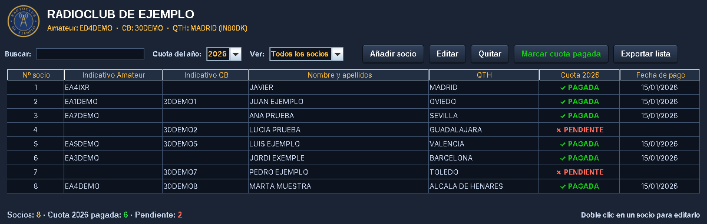
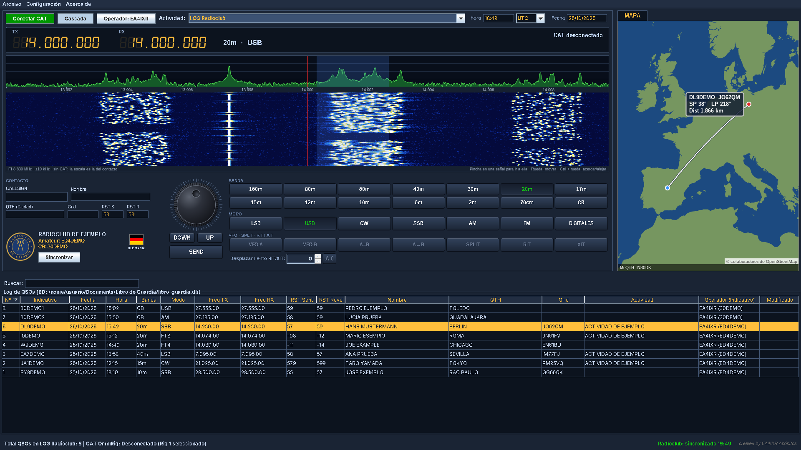

# Bitácora 26

*Libro de guardia (log de contactos) gratuito para Windows: radioaficionados, Banda Ciudadana (CB 27 MHz) y radioclubs.*

**Nace como un libro de guardia para radioaficionados, Banda Ciudadana y radioclubs.**

Bitácora 26 es un programa gratuito para Windows que sirve para anotar los contactos (QSO) de la estación de forma sencilla y sin perder ninguno, sin tener que estar con varias aplicaciones y anotaciones: todo en un mismo sitio. Está pensado tanto para las bandas de radioaficionado como para la CB (27 MHz), y además para gestionar de manera sencilla algunos aspectos de un radioclub.

Es un proyecto personal que nace a raíz de mi inexperiencia y de la cantidad de aplicaciones interesantes que se pueden usar para nuestra afición, pero reuniéndolo todo en un mismo sitio.

*Ventana principal: banda de 20 m en USB, cascada del receptor RTL-SDR, mapa con la estación y el log de contactos.*

---

## ⬇️ Descarga

👉 **[Descargar la última versión](https://github.com/ea4ixr/Bitacora-26/releases/latest/download/Bitacora.26.zip)** (archivo `Bitacora.26.zip`, el programa completo)

También puedes ver todas las versiones y sus novedades en [Descargas](https://github.com/ea4ixr/Bitacora-26/releases).

---

## ☕ Apoya el proyecto

Bitácora 26 nace de la afición por la radio y se comparte gratis con todos los colegas. Si te ayuda en tu estación o en tu radioclub y quieres invitarme a un café, te lo agradeceré mucho. ¡73 y buenos DX!

---

## ✨ Qué puede hacer

### Libro de guardia
- Anota indicativo, nombre, QTH, locator, banda, modo, frecuencia y reportes RST.
- La hora se guarda siempre en **UTC**. Puedes elegir verla en UTC o en hora local.
- Busca los datos del corresponsal en **QRZ.com** con tu propia cuenta (para ver todos los datos, QRZ.com pide su suscripción *XML Logbook Data*, que es de pago). En CB nunca se consulta QRZ.com.
- Muestra la estación en un **mapa** (mapa de © colaboradores de OpenStreetMap), junto con la bandera del país.
- Permite **importar y exportar ficheros ADIF** (`.adi`) para pasarlos a otros programas.
- Permite **varios operadores** en el mismo ordenador, cada uno con su contraseña y su log.
- Permite **unificar tus logs** aunque utilices la aplicación en distintos ordenadores: no perderás ningún contacto.

### Cascada (waterfall)
- Muestra el espectro en cascada con un receptor **RTL-SDR**.

### Actividades y diplomas
- Puedes crear actividades **simples** (a un contacto) o **por puntos y bandas**.
- Tiene un **generador de diplomas en PDF** que crea los diplomas de los QSO de la actividad con un solo clic.

### Servicios en Internet
- Sube los contactos a **QRZ.com Logbook** (mediante la API de QRZ.com, que es de pago), **eQSL, Club Log, HRDLog y HamQTH**.
- Cada operador configura sus propias cuentas. Para usar cada servicio hace falta tener cuenta en él y aceptar sus condiciones.

### Radioclub
- Lleva la gestión de **socios, cuotas y actividades** del radioclub.
- Hay un **LOG del Radioclub compartido** entre los socios, a través de una carpeta en la nube (Google Drive o similar) o de un servidor FTP.
- Los socios se unen con una **clave de invitación**.
- Hay varios **niveles de administración**: Radioclub, Superadmin, Admin y Socio.
- **Seguridad:** todo va con contraseña. Cada usuario crea la suya, y solo él puede entrar con su usuario, anotar contactos y modificar los suyos.

---

## 🖼️ Capturas

**Banda Ciudadana:** los 40 canales a un clic, con el 9 y el 19 destacados.

**Generador de diplomas:** colocas los datos sobre tu propia plantilla y se crean todos los diplomas de la actividad con un solo clic.

**Diploma generado** (en PDF):

**Radioclub: configuración.** Nombre, indicativos, logo y web del radioclub, y cómo se comparte con los socios (carpeta en la nube o FTP, clave de invitación y contraseña).

**Radioclub: gestión de socios y cuotas.** Altas, cuotas pagadas o pendientes por año y exportación de la lista.

**LOG del Radioclub compartido.** Cada contacto indica qué operador lo hizo y con qué indicativo del radioclub; el botón *Sincronizar* envía lo nuevo y recoge lo de los demás socios.

*Todos los indicativos, nombres y contactos de las capturas son inventados.*

---

## 💻 Requisitos

| Necesario | Para qué |
|---|---|
| Windows 10 u 11 de 64 bits | Siempre |
| [OmniRig](https://www.dxatlas.com/omnirig/) | Solo si quieres conectar la emisora (CAT) |
| Receptor RTL-SDR | Solo si quieres usar la cascada |
| [WSJT-X](https://wsjt.sourceforge.io/wsjtx.html) | Solo para FT8 / FT4 |

---

## 🚀 Instalación

1. Descarga **[`Bitacora.26.zip`](https://github.com/ea4ixr/Bitacora-26/releases/latest/download/Bitacora.26.zip)** (la última versión).
2. Descomprímelo donde quieras, por ejemplo en el Escritorio.
3. Abre la carpeta **Bitacora 26** y haz doble clic en **`Bitacora 26.exe`**.
4. La primera vez te pedirá los datos del operador: indicativo, nombre, QTH y locator.

Tus contactos y tu configuración se guardan en **Documentos\Libro de Guardia**. Si actualizas el programa a una versión nueva, no se pierde nada.

> **Windows puede mostrar un aviso** ("Windows protegió su PC") porque el programa no está firmado. Pulsa **"Más información" → "Ejecutar de todas formas"**.

---

## 📖 Primeros pasos

1. **Operador:** en *Configuración*, revisa tus datos de operador.
2. **Emisora:** en *Configuración → Configurar Emisoras*, añade tu emisora y el número de Rig que tiene en OmniRig. Después pulsa **Conectar CAT**.
3. **Anotar un contacto:** escribe el indicativo, completa los datos y guarda.
4. **Servicios en Internet:** en *Configuración → Configurar Servicios Online*, pon tus cuentas de QRZ, eQSL…
5. **Radioclub:** en *Configuración → Configurar Radioclub*. Si te han dado una clave de invitación, pégala ahí.

---

## ❓ Preguntas frecuentes

**¿Cuesta algo?**
No, es gratuito.

**¿Puedo usar WSJT-X y Bitácora 26 a la vez con la misma emisora?**
Sí. Los dos tienen que usar el mismo OmniRig. Se elige en *Configurar Emisoras* (OmniRig 1).

**¿Dónde están mis datos?**
En **Documentos\Libro de Guardia**. Haz copia de esa carpeta de vez en cuando.

---

## ⚖️ Avisos legales y créditos

**Bitácora 26 no está afiliado, patrocinado ni respaldado** por ninguno de los programas o servicios que se nombran en esta página. Sus nombres y logotipos son marcas de sus respectivos propietarios, y aquí se mencionan solo para indicar con qué es compatible el programa.

**Programas y servicios externos** (cada uno tiene sus propias condiciones de uso):
- [QRZ.com](https://www.qrz.com) · [eQSL](https://www.eqsl.cc) · [Club Log](https://clublog.org) · [HRDLog](https://www.hrdlog.net) · [HamQTH](https://www.hamqth.com)
- [OmniRig](https://www.dxatlas.com/omnirig/), de Afreet Software (programa gratuito, se instala aparte).
- [WSJT-X](https://wsjt.sourceforge.io/wsjtx.html), de K1JT y colaboradores (licencia GPL, se instala aparte).

**Datos y componentes incluidos:**
- Mapa: © colaboradores de [OpenStreetMap](https://www.openstreetmap.org/copyright), datos bajo licencia ODbL.
- Contornos del mapa del mundo: [Natural Earth](https://www.naturalearthdata.com) (dominio público).
- Banderas: [flag-icons](https://github.com/lipis/flag-icons), de Panayiotis Lipiridis (licencia MIT).
- Prefijos DXCC: derivados de [k0swe/dxcc-json](https://github.com/k0swe/dxcc-json) (licencia Apache 2.0), basado en la lista DXCC de la ARRL.
- [Apache PDFBox](https://pdfbox.apache.org) (Apache 2.0), [SQLite JDBC](https://github.com/xerial/sqlite-jdbc) (Apache 2.0) y [JACOB](https://github.com/freemansoft/jacob-project) (LGPL).
- [rtl-sdr / rtl_tcp](https://osmocom.org/projects/rtl-sdr/wiki) de Osmocom (licencia GPL 2.0).

Los textos completos de todas las licencias van en la carpeta **licencias** del programa.

**Privacidad:** los contactos que se ven en las capturas son **inventados**. Los datos que anotes en el programa se guardan en tu ordenador (y, si lo activas, en la carpeta o servidor que elijas para el radioclub). El programa solo se conecta a Internet para los servicios que tú configures, para buscar indicativos y para el mapa (OpenStreetMap, al que se envía el nombre del QTH que buscas).

El programa se ofrece **tal cual, sin garantías**. Úsalo bajo tu responsabilidad.

---

## 📬 Contacto

Javier Alguacil, **EA4IXR** · [QRZ.com/db/EA4IXR](https://www.qrz.com/db/EA4IXR)

Para avisar de un fallo o proponer una mejora, usa la pestaña **[Issues](https://github.com/ea4ixr/Bitacora-26/issues)** de esta página.

73 y buenos DX.
